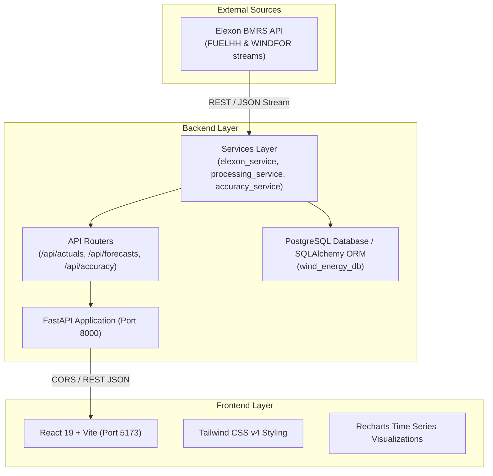

# Wind Energy Intelligence — Architecture

## System Components

1. **Elexon BMRS API**
   - **FUELHH stream**: Half-hourly outturn generation by fuel type (filtered for `fuelType=WIND`).
   - **WINDFOR stream**: Wind generation forecasts published by the National Grid ESO.
   - **Endpoints**: `/latest` (near real-time forecasts), `/history` (historical forecast snapshot per publication time), and `/evolution` (forecast trajectory for a target delivery period).

2. **Backend (FastAPI)**
   - High-performance asynchronous Python API using `httpx` and `pydantic`.
   - Data normalization engine via `pandas` and statistical metrics calculation via `numpy`.
   - Database layer configured with PostgreSQL and SQLAlchemy ORM for archiving time series.

3. **Frontend (React + Vite + Tailwind CSS)**
   - Ultra-fast client dashboard built with Vite and React.
   - Recharts for settlement period-level forecast vs. actual visualization.
   - Responsive design with Lucide icons and clean enterprise aesthetic.
